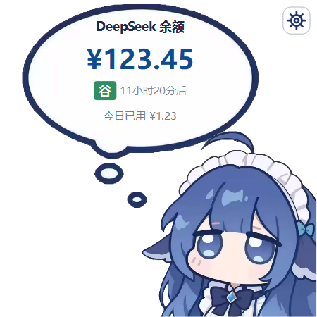
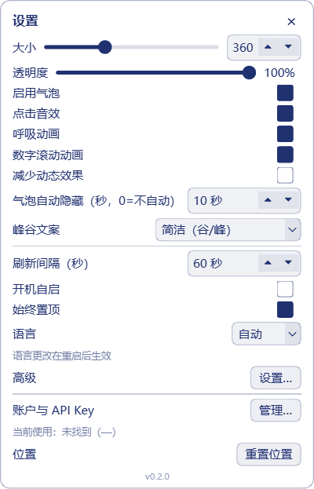

# DeepSeek 余额桌宠（DeepSeek Balance Pet）

**无需 DSH · 独立运行** —— 不需要 DSH，也不需要其他客户端；Windows + 一个 DeepSeek API Key 即可。

[English](README.en.md) · [配置说明](docs/configuration.md) · [隐私说明](docs/privacy.md) · [第三方声明](THIRD_PARTY_NOTICES.md)

> ### ⚠️ 免责声明
>
> - 本项目是**非官方个人项目**，与 DeepSeek 官方、DeepSeek Harness（DSH）以及原作者 **MeteorNOX** 均无隶属、合作或背书关系。
> - 余额与“今日已用”来自本机对 DeepSeek API 的观测/估算，可能与官方账单不同，**不能作为对账、报销或法律依据**。
> - API Key 由你自行保管；请自行确认 Key 的权限、账户安全和网络环境。因使用本软件产生的任何费用、数据或损失由使用者承担。
> - 软件按 MIT 许可“AS IS”提供，不提供任何明示或暗示担保。完整条款见 [DISCLAIMER.md](DISCLAIMER.md)。

> ### 🐋 原作者与素材致谢
>
> 小鲸鱼角色素材与点击音效来自 **MeteorNOX** 的 [DeepSeek-Balance-Whale-Widget](https://github.com/MeteorNOX/DeepSeek-Balance-Whale-Widget)，MIT 许可。
> 本项目是**独立实现**，不是 DSH 插件，也不代表原作者；详见 [THIRD_PARTY_NOTICES.md](THIRD_PARTY_NOTICES.md)。



## 这不是 DSH 插件

本项目是一个**完全独立的 Windows 桌面程序**，与 DSH（DeepSeek Harness）无关：

- 不需要安装 DSH，不读取 `.dsh` 目录，不调用 `dsh plugin`；
- 不需要其他客户端；复用本机已有工具里的 DeepSeek Key 只是可选便利功能；
- 只需要 Windows 10/11（x64）和一个 DeepSeek API Key。

## 功能

- 🐋 透明、置顶、可拖拽的桌面鲸鱼娘，位置自动记住。
- 💬 点击鲸鱼后气泡**约 0.75 秒分三段形成**：先出现下面的小圈，再出现中圈，最后长成大气泡，文字最后浮现；有气泡时再点只刷新，不会收起；默认 **10 秒**后自动淡出。
- ⚙️ 窗口右上角常驻齿轮按钮，点开是原版风格的紧凑设置浮层；浮层开着时鲸鱼仍可正常使用。
- 💰 后台 60 秒刷新；显示气泡时立即刷新；金额变化有数字滚动动画。
- 📊 今日已用：气泡底部显示 `今日已用 ¥x.xx`；按余额下降观测累计，充值/赠金不会冲掉已用；跨天（北京时间）自动重置。
- ⛰️ 峰谷状态做成方块徽章居中：高峰是红色方块白字「峰」，低谷是绿色方块白字「谷」；紧挨着右边显示距离下一次切换的大概时间，例如 `[谷] 12小时55分后`。
- 🎨 峰谷文案风格可切换：默认（高峰期/低谷期）/ 梁文峰谷 / !?强强?! / 简洁（谷/峰，默认）。选长文案时徽章会自动变宽。
- 🔊 原版「小黄鸭」点击音效：**按下鼠标的瞬间就响一次**，连点会立即重新触发；按住不会持续响；使用 SDL 8 通道混音并跟随系统当前输出设备。开关在设置浮层 →「点击音效」。
- 🎚️ 设置里拖动**大小 / 透明度**会实时预览并立即保存。
- 🪞 角色按屏幕位置自动转向屏幕中心：在左半边朝右，在右半边朝左。
- 📶 断网/超时保留上次余额；底部行仍显示今日已用，并标「离线」。
- 🔑 前端可更换 Key、测试连接、清除自定义 Key。
- 🔒 自定义 Key 用 Windows DPAPI 加密存储，日志全部脱敏。
- ✨ 60 FPS 呼吸动画、抗锯齿字体，气泡内文字居中排版。
- 🌏 中英双语界面，跟随系统语言。
- 🧾 余额接口只访问 `https://api.deepseek.com`，无遥测。

### 气泡、峰谷与今日已用

- 气泡默认隐藏；点一下鲸鱼后约 0.75 秒按「小圈 → 中圈 → 大气泡」的顺序形成，再点只刷新；默认 10 秒后自动淡出（可在设置里改，0 = 不自动）。
- 气泡使用原版手绘气泡皮肤；文字全部居中。
- 高峰时段：北京时间周一至周五 **9:00–12:00、14:00–18:00**。
- 其余时间（包括周末、调休上班的周末、中国法定节假日全天）按低谷计费。
- 峰谷状态是方块徽章，和大概时间一起居中：
  - 低谷：绿色方块 + 白色「谷」，右边跟 `12小时55分后`；
  - 高峰：红色方块 + 白色「峰」，右边跟 `2小时5分后`；
  - 只精确到 5 分钟；不到 5 分钟显示「即将」；超过 24 小时显示「X天Y小时」。
- 气泡底部显示 `今日已用 ¥1.23`：按余额下降观测累计；充值/赠金不会冲掉已用；跨天（北京时间）自动重置。
- 峰谷规则与原 DSH 小鲸鱼插件一致，节假日清单在 `src/deepseek_pet/peak.py` 中维护。

## 运行前需要准备什么

| 项目 | 是否必需 | 说明 |
|---|---|---|
| Windows 10/11 x64 | 是 | 免安装包和源码都只针对 Windows |
| DeepSeek API Key | 是 | 在 [DeepSeek 开放平台](https://platform.deepseek.com) 的 API Keys 页面创建；只保存在本机 |
| Python 3.10+ | 仅源码运行 | 免安装 exe 不需要 Python；本项目在 Python 3.12 上验证 |
| 代理（可选） | 否 | 网络需要时在设置浮层 →「高级」里填写 |
| 准确的系统时间 | 建议 | 峰谷与“今日已用”的跨天判断按北京时间计算 |

> 不需要 DSH，也不需要其他客户端。DeepSeek API Key 是唯一必须准备的东西。

## 快速开始

### 方式一：免安装包（推荐）

1. 从 [Releases](../../releases/latest) 下载 `DeepSeekPet-0.2.0-win-x64.zip`。
2. 解压到**一个固定、以后不会移动或删除的目录**（不要放临时目录）。
3. 双击 `DeepSeekPet.exe`。
4. 首次启动向导会检测可用 Key：
   - 选择「使用这个 Key」直接开始；
   - 或选择「自己填写 Key」粘贴 DeepSeek API Key；
   - 或「先跳过」，之后点右上角齿轮 →「账户与 API Key」→「管理…」里填。

向导完成后，桌宠出现在右下角；**气泡默认隐藏，点一下鲸鱼才显示余额**。

> exe 未做代码签名，首次从网上下载运行时 Windows SmartScreen 可能提示「未知发布者」。确认来源和 SHA256 后，选择「更多信息 → 仍要运行」。

### 方式二：源码运行

需要 Python 3.10+（本项目在 Python 3.12 上验证）：

```powershell
# 在本仓库页面点击 Code，复制 Clone 地址后
git clone https://github.com/jiejiejie171/deepseek-balance-pet.git
cd deepseek-balance-pet
python -m pip install -e .
python -m deepseek_pet
```

无控制台窗口启动（使用 Python 安装目录里的 `pythonw.exe`）：

```powershell
pythonw -m deepseek_pet
```

命令行检查（不开 GUI）：

```powershell
python -m deepseek_pet --check
```

## 首次配置

Key 来源优先级：

1. 本程序设置里的**自定义 Key**（DPAPI 加密）；
2. 环境变量 `DEEPSEEK_API_KEY`；
3. 可选的、本机已有工具的用户配置（程序会自动检测）。

自定义 Key 存在 `%APPDATA%\DeepSeekPet\secrets.bin`，配置存在 `%APPDATA%\DeepSeekPet\config.json`。
把程序目录放进 `portable.txt` 可切换为便携模式，配置改存到程序目录下的 `data\`。

首次配置步骤：

1. 启动后按向导选择/填写 Key；
2. 点「测试连接」确认能读到余额；
3. 点一下鲸鱼验证气泡与余额；
4. 需要代理或自定义 API 地址时，打开设置浮层 →「高级」→「设置…」；
5. 需要开机自启时，在设置浮层里打开「开机自启」。

## 设置

点右上角**齿轮**（或右键鲸鱼 / 托盘图标 →「设置…」）打开**原版风格的紧凑浮层**，改动立即生效：

- 大小 / 透明度：拖动时实时预览。
- 启用气泡、点击音效、呼吸动画、数字滚动动画、减少动态效果。
- 气泡自动隐藏秒数、峰谷文案、刷新间隔。
- 开机自启、始终置顶、语言（重启后生效）。
- 高级：超时 / 代理 / API 地址（点「设置…」）。
- 账户与 API Key：点「管理…」打开子窗口，可粘贴/测试/清除自定义 Key。
- 位置：重置；底部小号版本号点开「关于」。

浮层是**非模态**的：它开着的时候鲸鱼照样可以点、拖、刷新；点右上角 ×、再点齿轮或按 Esc 关闭。



## 常见问题

**启动后提示「未找到 API Key」？**
点右上角齿轮 →「账户与 API Key」→「管理…」，粘贴 DeepSeek API Key 并点「测试连接」。

**提示「Key 无效或无权限」？**
确认 Key 属于 DeepSeek 开放平台，并且没有过期；也确认没有把别的厂商 Key 填进来。

**连接超时/网络失败？**
检查网络或代理。可以在设置浮层 →「高级」→「设置…」里填写 `http://127.0.0.1:7897` 这类代理地址。

**为什么气泡里显示的是旧金额？**
断网或接口失败时会保留上次成功金额；底部行仍显示「今日已用 ¥x.xx · 离线」。

**为什么今日已用是 ¥0.00？**
“今日已用”从当天第一次成功读取余额开始累计；余额下降才会增加。它不是官方账单，也不包含安装/启动前的历史消费。

**需要 DSH 吗？**
不需要。本项目不读取 `.dsh`，不调用 `dsh`。

**日志在哪里？**
`%APPDATA%\DeepSeekPet\pet.log`，已自动脱敏，不会写入完整 API Key。

**exe 运行后没有命令行输出？**
发布包是 GUI 程序（`console=False`），`--check` 的输出看不到；需要命令行检查时请用源码方式运行。

## 隐私

- 只访问 `https://api.deepseek.com/user/balance` 查询余额；
- 不收集、不上传任何遥测或使用数据；
- Key 只存在 DPAPI 密文或你原来的配置位置；
- 日志会脱敏 `sk-...`。

详见 [docs/privacy.md](docs/privacy.md)。

## 免责声明（摘要）

本项目是非官方项目，与 DeepSeek 官方、DSH 以及原作者 MeteorNOX 均无隶属或背书关系。余额和今日已用是本地观测估算，不构成官方账单；API Key 由你自行保管，使用风险自负。完整条款见 [DISCLAIMER.md](DISCLAIMER.md)。

## 卸载

1. 右键鲸鱼 →「退出」；
2. 删除程序目录；
3. 删除 `%APPDATA%\DeepSeekPet`（或便携模式下的 `data` 目录）；
4. 如果开过开机自启，在设置浮层里关闭「开机自启」，或删除注册表
   `HKCU\Software\Microsoft\Windows\CurrentVersion\Run` 下的 `DeepSeekPet`。

## 开发

```powershell
python -m pip install -e ".[dev]"
python -m pytest -q
python -m ruff check src tests
powershell -NoProfile -ExecutionPolicy Bypass -File packaging/build.ps1
```

更多见 [CONTRIBUTING.md](CONTRIBUTING.md)、[docs/build.md](docs/build.md)。

## 致谢与许可

- **原作者/角色素材/点击音效**：MeteorNOX，[DeepSeek-Balance-Whale-Widget](https://github.com/MeteorNOX/DeepSeek-Balance-Whale-Widget)，MIT。
- 本项目代码：MIT，见 [LICENSE](LICENSE)。
- 完整第三方声明：[THIRD_PARTY_NOTICES.md](THIRD_PARTY_NOTICES.md)。
- 本项目是独立实现，不是 DSH 插件，也不代表原作者或 DeepSeek 官方。
